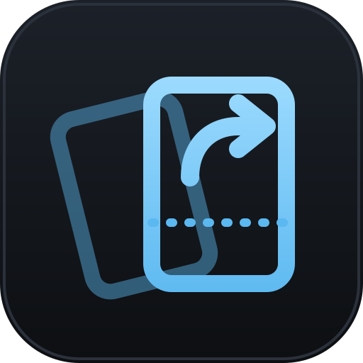
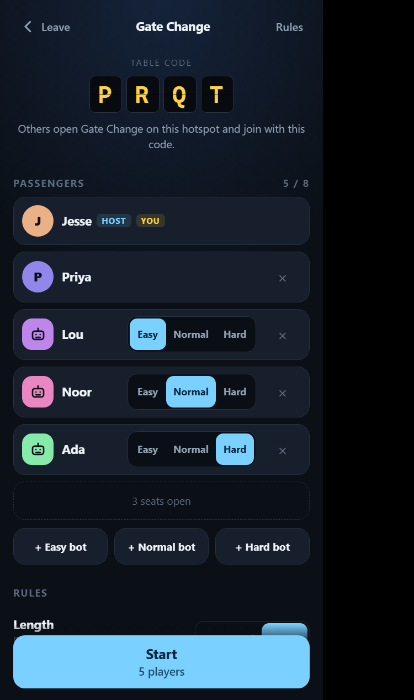
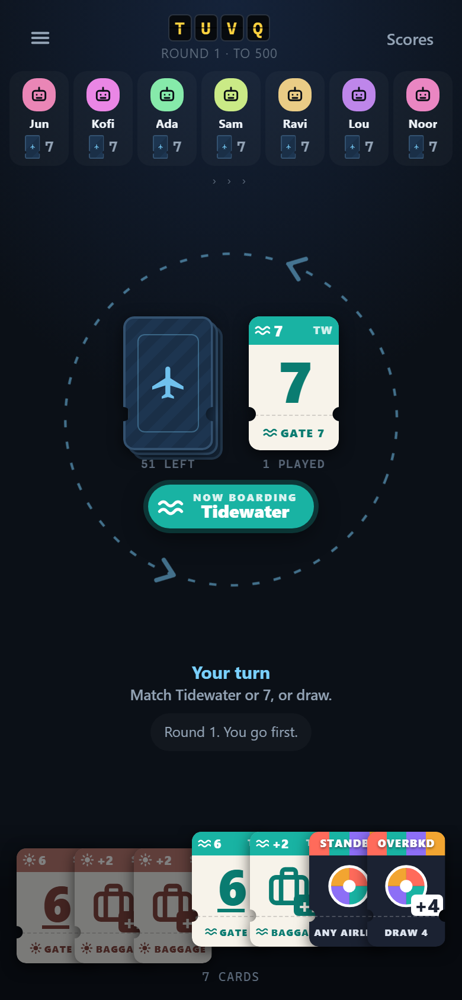

<p align="center"></p>

# Gate Change: a card game for the departure lounge

An [AirplaneMode](https://github.com/jessewolcott/airplanemode) app. A colour-and-number
shedding card game with an airport theme. Play against bots on your own, or play with everyone
on the hotspot, phone to phone, with no internet.

<p align="center">
  
  
</p>

<sub>Screenshots from a laptop browser at phone size; not yet tested on real hardware or real phones.</sub>

## How to play

Everyone gets 7 cards. On your turn, play a card that matches the **airline** of the top card or
its **number or symbol**. Empty your hand first to win the round.

| Airline | Colour | Symbol |
|---|---|---|
| Sunward | coral | sun |
| Tidewater | teal | waves |
| Starline | violet | star |
| Summit | amber | mountain |

Every card shows its airline's symbol, so nobody has to tell the colours apart.

- **Can't or won't play?** Draw one card. If it fits, you may play it straight away;
  otherwise your turn ends.
- **Delayed**: the next player misses a turn.
- **U-Turn**: play changes direction (with two players it works like Delayed).
- **Extra Baggage +2**: the next player draws 2 and misses a turn.
- **Standby** (wild): play it on anything and pick the next airline.
- **Overbooked +4** (wild): pick the airline; the next player draws 4 and misses a turn. They
  can **challenge** it: if you held a card of the airline that was showing, you draw 4 instead
  (and they play on). If you didn't, they draw 6.
- **Last call!** When you go down to one card, press the Last call button (on your turn while
  holding two, or right after playing). If anyone catches you before the next player moves, you
  draw 2.

The round's winner scores the cards left in everyone else's hand: numbers at face value,
action cards 20, Standby and Overbooked 50. A table plays one round or rounds until someone
reaches 500.

House rules the host can switch on in the lobby: **Stack +2 on +2** (answer a +2 with a +2;
the total moves on) and **Draw until you can play**.

Small print: the first card turned up is always a number, a round ends the moment a hand is
empty (a final action card has no effect), and if nobody can play and nothing is left to draw
the lightest hand wins the round.

## Tables and bots

- **Play vs bots**: one tap, you and three normal bots, first to 500.
- **Host a game**: a table with a 4-letter code. Others join with the code or by tapping it
  under *Departures on this hotspot*. The host adds bots (easy, normal or hard), sets the rules
  and starts. Up to 8 seats.
- **Bots**: *easy* plays any legal card and sometimes forgets Last call; *normal* holds its
  wilds, saves action cards for the leader and names the airline it holds most; *hard* also
  hits a player about to go out, names airlines the next player has run out of, and challenges
  a +4 when the odds say it was a bluff.
- **Phones lock and people wander off.** Your seat is tied to your browser, so a refresh or an
  unlocked phone puts you straight back, autopilot off. An open page checks in at least every
  20 seconds; after 45 seconds with no contact from your phone your seat shows as *away*, but
  that's only a label until your turn comes. On your turn a bot takes over (autopilot) if you're
  away, or if 60 seconds pass with nothing happening at the table (the clock restarts on any
  change at the table, such as someone's Last call, so it usually runs from the move that made
  it your turn). Autopilot keeps playing for you until you tap *Take my seat back*, make a
  move yourself, or come back to the page.
- **Between rounds** the table waits for *Next round*, which anyone seated can press. If every
  person at the table is away, on autopilot or has left, the next round starts on its own after
  a few seconds.
- **Rematch** keeps the table; *Change the table* goes back to the lobby.

Everything is kept in memory: no accounts, no files, nothing written to disk. Idle tables go
after 2 hours. The box keeps up to 200 tables; when it's full, a new table replaces the least
recently used lobby or finished game. A game in progress is never closed to make room: if all
200 tables are mid-game, *Host a game* and *Play vs bots* say so until one finishes.

## Running it

**On the box:** the platform repo runs the released image at `/gatechange/`.

**On its own, for development:**

```
docker compose up -d --build          # http://localhost:8771
python tests/test_gatechange.py       # rules, bots, rooms and API (CI runs these before building)
```

## Settings

| Variable | Default | Meaning |
|---|---|---|
| `GATECHANGE_BOT_DELAY` | `1.0` | seconds a bot "thinks" before moving |
| `GATECHANGE_AWAY` | `45` | seconds without contact before autopilot takes a seat |
| `GATECHANGE_IDLE_TURN` | `60` | seconds someone may sit on their turn before autopilot plays it |
| `GATECHANGE_MAX_ROOMS` | `200` | tables kept at once (lobbies and finished games make way; games in progress never do) |
| `GATECHANGE_ROOM_IDLE` | `7200` | seconds (2 hours) a table may sit untouched before it's dropped |
| `GATECHANGE_POLL_WAIT` | `20` | seconds a phone's request waits for news before answering anyway; keep it well under `GATECHANGE_AWAY` |
| `GATECHANGE_SEED` | *(empty)* | fixed seed for repeatable deals (testing) |

*Not yet tested on real hardware.*
